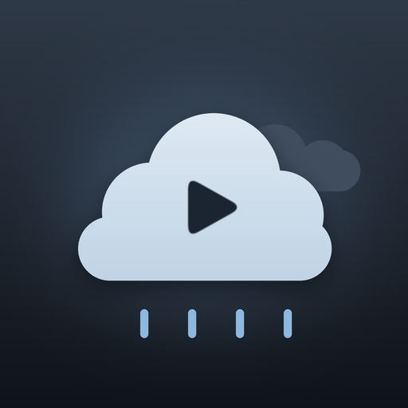

# ☁️ Nublado — tema para Kino TV

Un tema oscuro de **cielo nublado** para toda la app de Kino (celular y TV): grises azulados, un acento celeste suave, esquinas redondeadas, bordes finos, controles del reproductor más cómodos y un **logo propio de nube con botón de play** que reemplaza al de Kino en el menú, la cabecera y el riel del TV.

Es un plugin **solo de temas**: los temas son datos dentro de `kino-plugin.json`. No ejecuta código, no usa red y no pide ninguna capacidad ni permiso (`"hosts": []`).



## Requisitos

| Qué | Versión |
|---|---|
| Kino (tema, colores, logo, formas, reproductor) | **0.9.81** o posterior (`apiVersion: 18`) |
| Bordes finos (`border`, `*Border`) | 0.9.82 o posterior; en 0.9.81 se ignoran y el tema se ve igual, sin bordes |

Un Kino anterior a 0.9.81 rechaza el plugin con «Este plugin necesita una versión más nueva de Kino».

## Archivos

```
theme-nublado/
├── kino-plugin.json   # manifiesto + el tema (appThemes) + logo vectorial
├── plugin.js          # vacío a propósito: export {};
├── icon.png           # icono 512×512 (50 KB), vinculado en "icon"
└── README.md
```

El icono está vinculado directamente en el manifiesto con `"icon": "icon.png"` (ruta relativa, sin `./`, PNG cuadrado de máximo 128 KB, como exige Kino).

## Instalar y usar

1. Sube la carpeta a un repositorio de GitHub (o instala desde tu tienda de plugins) siguiendo la guía [Publicar](https://kinotvapp.github.io/kino-plugins/publish/).
2. Instala el plugin en Kino.
3. Ve a **Ajustes ▸ Apariencia**, elige **Nublado** y toca **Usar este tema**.
4. Kino preguntará si quieres la **experiencia completa** (sombras y esquinas redondeadas), con la que este tema se ve mejor. Es opcional: nada cambia sin tu sí.

Si desactivas o quitas el plugin, Kino vuelve a su tema original; la elección se recuerda si lo reinstalas.

## Paleta

| Token | Color | Uso |
|---|---|---|
| `accent` | `#8FB8DE` | Celeste: botones, selección, acento del reproductor |
| `onAccent` | `#0E1217` | Texto e íconos sobre el acento |
| `background` | `#10141A` | Fondo (con degradado `#222B36` → `#10141A`) |
| `surface` | `#1E252E` | Tarjetas y paneles |
| `surfaceHigh` | `#2A3340` | Paneles elevados |
| `railPanel` | `#171C23` | Riel lateral del TV |
| `textPrimary` / `textSecondary` | `#EEF2F6` / `#A9B4C0` | Texto |
| `focus` / `onFocus` | `#E8F1F9` / `#10151B` | Marcador de foco del TV |
| `outline` / `border` | `#3A4654` / `#4A5A6C` | Líneas y bordes |
| `success` / `warning` / `error` / `favorite` | `#7FD1AE` / `#E6C27A` / `#E88A8A` / `#F2A7C3` | Estados |

Contrastes calculados contra las protecciones de legibilidad de Kino (4,5:1 para texto, 3:1 para acento y foco):

| Par | Contraste |
|---|---|
| Acento sobre fondo | 8,9:1 |
| `onAccent` sobre acento | 9,0:1 |
| Texto principal sobre fondo / tarjetas / paneles elevados | 16,4 / 13,7 / 11,3:1 |
| Texto secundario sobre fondo / tarjetas | 8,8 / 7,3:1 |
| Foco sobre fondo | 16,2:1 |

Los dos extremos del degradado son oscuros (luminancia ≤ 0,05), requisito de Kino para el fondo.

## Forma, movimiento y reproductor

- **Esquinas:** tarjetas y canales 16, botones 22, chips 20, diálogos 22, campos 14.
- **Bordes (0.9.82+):** 1 dp en diálogos, menús, cabeceras y paneles; las tarjetas van sin borde.
- **Tipografía:** escala 1,0 con títulos a 1,05; en TV la escala sube a 1,05.
- **Sombras:** tarjetas 0,35, diálogos 0,6, velo del héroe 0,7.
- **Movimiento:** zoom de foco 1,06 (1,08 en TV), fundido de 350 ms, deriva del héroe activada. Se desactiva solo si la persona reduce los efectos.
- **Reproductor:** botones circulares, botón de play al 120 %, barra de progreso al 120 %.

## Lo que la persona puede ajustar

En **Ajustes ▸ Apariencia ▸ Personalizar**:

- Color de acento: celeste, índigo, turquesa o ámbar suave (muestras compatibles con control remoto).
- Redondeo de las tarjetas: 0 a 24.
- Tamaño del texto: 0,95 a 1,2.
- Tamaño de los botones del reproductor: 0,9 a 1,3.
- Fondo (degradado o color liso).

Cada color de muestra ya fue verificado contra las protecciones de contraste.

## Logo

Definido como vectores en `appThemes[0].logo` (sin imágenes ni red), con colores que siguen al tema:

- **`wordmark`** (128×30): nube con play en celeste + «KIN» en `textPrimary` + «O» en el acento. Se usa en el menú y la cabecera del celular y en el riel abierto del TV.
- **`mark`** (39×30): la nube con play, para el riel cerrado del TV.

Kino conserva su propio logo en la pantalla de inicio, la puerta de entrada y las pantallas que piden una decisión; eso no lo puede cambiar ningún tema.

## Probar en local

Con el kit de plugins de Kino (`sdk/`):

```bash
node sdk/validate.mjs .
```

No debería mostrar advertencias de rango ni de contraste, en celular ni en TV. Después revisa el aspecto real en Kino: **Ajustes ▸ Apariencia ▸ vista previa**.

## Editar el tema

- **No cambies nunca el `id` del tema** (`nublado`) una vez publicado: de él cuelgan la elección y los ajustes de la persona.
- Sube `version` en cada publicación (`MAJOR.MINOR.PATCH`).
- Si cambias colores, respeta el fondo oscuro y los contrastes mínimos, o Kino volverá al valor propio en el lado que falle.
- Para agregar tu nombre y enlaces, añade al manifiesto `"author"`, `"homepage"` y, si usas Kino Social, `"creator"`.

## Ideas para una próxima versión

- Una pantalla de presentación con botón «Activar / Desactivar» usando `go.useTheme` y `activeTheme` (capacidad `screen`).
- Una variante **Nublado claro** (fondo claro con su propio `textPrimary` y `textSecondary`; necesita Kino 0.9.82).
- `decor` en el logo (0.9.82) para dibujar una pequeña nube sobre la «o» del logo de Kino.

## Documentación

- [Temas de la app](https://kinotvapp.github.io/kino-plugins/themes/)
- [Manifiesto](https://kinotvapp.github.io/kino-plugins/manifest/)
- [Publicar](https://kinotvapp.github.io/kino-plugins/publish/)
